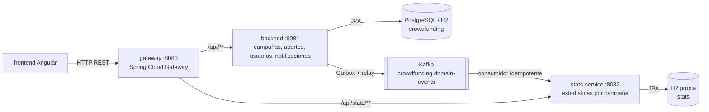

# Arquitectura de Crowdfunding G7 (tal como está construida)

Plataforma de financiamiento colectivo: los creadores publican campañas con meta, fecha límite e hitos; los
aportantes contribuyen dinero; el sistema avisa cuando llega un aporte, cuando una campaña está por cerrar, cuando
alcanza su meta y cuando cierra. Este documento describe **lo que existe en el código** del commit entregado; lo
que no está construido aparece marcado como **Propuesta**.

## Vista general

| Servicio | Carpeta | Puerto | Persistencia | Responsabilidad |
|---|---|---|---|---|
| Gateway | `gateway/` | 8080 | — | Punto de entrada único; enruta `/api/stats/**` a stats-service y el resto de `/api/**` al backend; asigna `X-Correlation-Id` |
| Backend (core) | `backend/` | 8081 | PostgreSQL (perfil `postgres`) o H2 (perfil `dev`) | Campañas, aportes, usuarios y notificaciones; escribe sus eventos de dominio en un Outbox transaccional |
| stats-service | `stats-service/` | 8082 | H2 propia (`./data/stats`) | Modelo de lectura con estadísticas por campaña, alimentado solo por eventos |
| Kafka | `docker-compose.yml` | 9092 | — | Transporte de los eventos de dominio |

## Estilo arquitectónico dentro de cada servicio

- **Backend:** DDD + Clean + Hexagonal. Por módulo (`campaign`, `contribution`, `notification`, `user`) hay
  `domain` (Java puro, verificado con ArchUnit en `ArchitectureTest`), `application` (casos de uso y puertos
  `port/in` y `port/out`) e `infrastructure` (adaptadores web, JPA, scheduling).
- **stats-service:** `domain` (`CampaignStats`, `ProcessedEvent`), `application` (`StatsProjector`) e
  `infrastructure` (`persistence`, `messaging`, `web`).

## Comunicación entre servicios

| Conexión | Tipo | Por qué |
|---|---|---|
| frontend → gateway → backend | **Síncrona** (HTTP REST) | El usuario espera la respuesta para continuar (crear campaña, aportar); necesita confirmación o error inmediato |
| frontend → gateway → stats-service | **Síncrona** (HTTP REST) | Consulta de lectura que el usuario espera en pantalla |
| backend → Kafka → stats-service | **Asíncrona** (eventos) | Las estadísticas no deben frenar ni hacer fallar un aporte; basta con consistencia eventual. Si stats-service cae, el backend sigue y el servicio se pone al día al volver |

## Observabilidad

`/actuator/health` y `/actuator/metrics` en los tres servicios; métricas propias `crowdfunding.outbox.dispatched` y
`crowdfunding.outbox.failed`. El `X-Correlation-Id` se asigna en el gateway (`CorrelationIdGatewayFilter`), el
backend lo pone en el MDC (`CorrelationIdFilter`), lo guarda con cada evento del Outbox y lo envía en la cabecera
del mensaje de Kafka; `stats-service` lo restaura al proyectar. Cada línea de log muestra `[servicio,id]`.

## Decisiones de arquitectura (ADR)

### ADR-01 · Extraer las estadísticas a un servicio propio alimentado por eventos

- **Estado:** Aceptada (implementada en `stats-service/`).
- **Contexto:** las consultas de estadísticas (aportes y total por campaña, ranking) recorren muchas filas de
  aportes y competirían con las escrituras del backend.
- **Decisión:** un servicio de lectura independiente, con su propia base, que construye sus datos a partir de los
  eventos `ContributionRegistered`, `GoalReached` y `CampaignClosed`.
- **Alternativa considerada:** calcularlas en el backend con consultas SQL de agregación sobre `contributions`.
  Es más simple y siempre exacta, pero acopla lectura y escritura en la misma base y el mismo proceso.
- **Consecuencias:** positiva, la lectura escala y falla por separado. Negativa: **consistencia eventual** (las
  cifras pueden ir unos segundos atrás) y una pieza más que operar (Kafka y el servicio).

### ADR-02 · Publicar eventos con Transactional Outbox en lugar de enviarlos directo a Kafka

- **Estado:** Aceptada (`JpaDomainEventOutbox`, `OutboxRelay`, `KafkaDomainEventForwarder`).
- **Contexto:** guardar un aporte y avisar a otros servicios son dos escrituras en sistemas distintos.
- **Decisión:** el evento se guarda en `outbox_events` dentro de la misma transacción que el cambio de negocio; un
  relay lo publica después, con reintentos y backoff exponencial.
- **Alternativa considerada:** llamar a `KafkaTemplate.send` dentro del caso de uso. Más directo, pero si Kafka cae
  después del commit el evento se pierde, y si se envía antes del commit puede anunciarse algo que luego se revierte.
- **Consecuencias:** positiva, ningún evento se pierde. Negativa: entrega **al menos una vez** (puede haber
  duplicados), por lo que los consumidores deben ser idempotentes, y hay una tabla más que limpiar con el tiempo.

### ADR-03 · Consumidor idempotente por `eventId` en stats-service

- **Estado:** Aceptada (`ProcessedEvent`, `StatsProjector`).
- **Contexto:** por la ADR-02 un mismo evento puede llegar dos veces; sumar dos veces un aporte falsearía el total.
- **Decisión:** registrar cada `eventId` aplicado en `processed_events` en la misma transacción que el cambio, e
  ignorar los repetidos.
- **Alternativa considerada:** exactly-once de Kafka (transacciones del productor y del consumidor). Requiere que
  toda la cadena sea transaccional en Kafka, incluida la base del consumidor, lo que no se cumple aquí.
- **Consecuencias:** positiva, reentregas y reprocesos no cambian las cifras. Negativa: la tabla
  `processed_events` crece sin límite y requerirá una política de retención.

### ADR-04 · API Gateway con rutas estáticas, sin descubrimiento de servicios

- **Estado:** Aceptada (`gateway/`).
- **Decisión:** Spring Cloud Gateway con las direcciones de los servicios en configuración
  (`STATS_SERVICE_URL`, `CORE_SERVICE_URL`).
- **Alternativa considerada:** Eureka para que el gateway descubra las instancias (`lb://`).
- **Consecuencias:** positiva, una pieza menos para tres servicios. Negativa: escalar a varias instancias de un
  servicio exige cambiar la configuración a mano; no hay balanceo automático.

### ADR-05 · Propuesta: extraer `notification` del backend

- **Estado:** **Propuesta** (no implementada: las notificaciones siguen dentro del backend).
- **Decisión propuesta:** mover el módulo `notification` a un servicio que consuma los mismos eventos de Kafka.
- **Alternativa:** dejarlo en el backend, como está hoy.
- **Consecuencias:** separaría su escalado y sus fallos, pero obliga a replicar la lista de aportantes por
  campaña (hoy se lee por SQL de la tabla `contributions`) y a resolver la autorización sin la tabla `users`.

## Propuestas fuera del alcance construido

- **Propuesta:** Dead Letter Topic y reintentos en el consumidor de stats-service (Lección 9).
- **Propuesta:** imágenes Docker de los servicios y CI con GitHub Actions (Lección 11).
- **Propuesta:** Eureka si se necesitan varias instancias por servicio (ver ADR-04).
