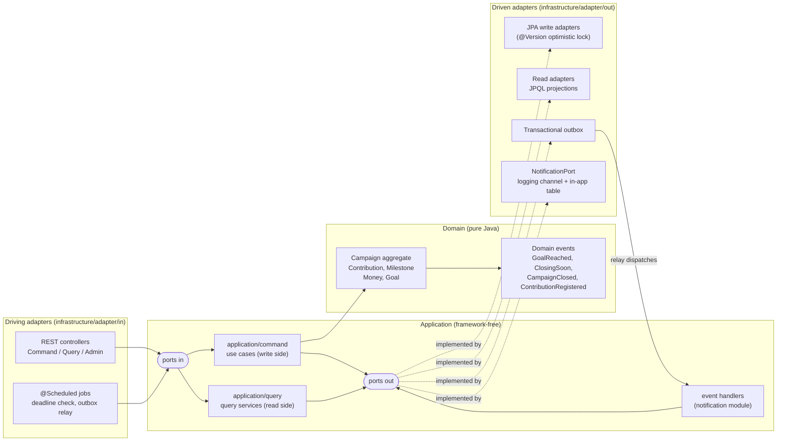
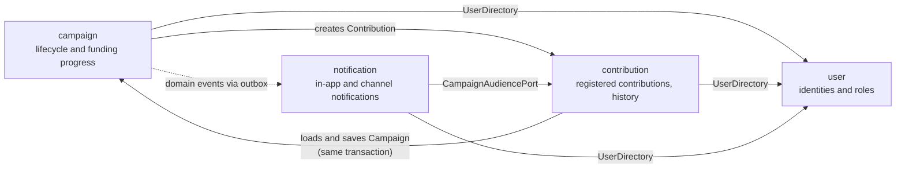

# G7 Impulsa: Crowdfunding Platform

A crowdfunding platform built for the course project. Creators publish campaigns with a funding goal and a deadline, contributors fund them, and a platform admin supervises. Unattended reactions (goal reached, closing soon, closed) run from domain events.

- **Backend**: Spring Boot 3.5 (Java 21 bytecode, runs on JDK 21+), domain-driven design (see [2.3](#23-domain-driven-design)), hexagonal + clean architecture, screaming architecture by feature, CQRS, transactional outbox.
- **Frontend**: Angular 20 (standalone components, signals, new control flow, SCSS), organized by feature with container/presentational components.

---

## 1. Quick start

Prerequisites: JDK 21+ and Node 20.19+. Maven is **not** required because the Maven wrapper is included.

```bash
# Backend: http://localhost:8081 (H2 in-memory, zero setup, demo data seeded)
cd backend
./mvnw spring-boot:run

# Frontend: http://localhost:4200 (proxies /api to :8081)
cd frontend
npm install
npm start
```

Use the user selector in the header to "log in as" one of the demo users:

| User | Roles | Id |
|---|---|---|
| Ana Gómez | CREATOR, CONTRIBUTOR | `11111111-1111-1111-1111-111111111111` |
| Diego Pérez | CREATOR, CONTRIBUTOR | `44444444-4444-4444-4444-444444444444` |
| Bruno Díaz | CONTRIBUTOR | `22222222-2222-2222-2222-222222222222` |
| Carla Ruiz | CONTRIBUTOR | `33333333-3333-3333-3333-333333333333` |
| Admin G7 | ADMIN | `99999999-9999-9999-9999-999999999999` |

The seeder creates campaigns in every state. Two of them are useful for demos:

- **Taller de robótica para niñas**: its deadline is 3 minutes after startup. You can watch the scheduler close it (HU-06) and notify its contributors.
- **Documental sobre el río**: it closes within 24 h, so it emits `ClosingSoon`. Its contributors list is private (HU-08).

### Running with PostgreSQL

```bash
docker compose up -d                                        # postgres:16 on :5432
cd backend
./mvnw spring-boot:run -Dspring-boot.run.profiles=postgres  # DB_URL / DB_USER / DB_PASSWORD override defaults
```

### Tests

```bash
cd backend && ./mvnw test      # domain, application (in-memory fakes), integration, ArchUnit
cd frontend && npm run build   # production build
cd frontend && npm test        # Karma specs (needs Chrome/Chromium installed)
```

### Useful URLs

- Swagger UI: http://localhost:8081/swagger-ui.html
- H2 console (dev profile): http://localhost:8081/h2-console (JDBC URL `jdbc:h2:mem:crowdfunding`, user `sa`)
- Health: http://localhost:8081/actuator/health

---

## 2. Architecture

### 2.1 Hexagonal layers



Dependency rule: `infrastructure → application → domain`. It is enforced by `ArchitectureTest` (ArchUnit):

- `domain` has no dependency on Spring, JPA, Hibernate, Jackson, `application` or `infrastructure`.
- `application` has no dependency on `infrastructure`, Spring or JPA. Transactions go through the `TransactionRunner` port.
- `application.query` never uses the write repositories (`CampaignRepository`, `ContributionRepository`) or command services.

Application services are plain classes, wired by `@Configuration` classes in `<module>/infrastructure/config`.

### 2.2 Screaming architecture (backend packages)

```
com.g7.crowdfunding
├── campaign
│   ├── domain/{model,event,exception}          Campaign aggregate, Goal, Milestone, events
│   ├── application/{port/in,port/out,command,query}
│   └── infrastructure/{adapter/in/web, adapter/out/persistence, scheduling, config}
├── contribution
│   ├── domain/{model,exception}                Contribution entity
│   ├── application/{port/in,port/out,command,query,exception}
│   └── infrastructure/{adapter/in/web, adapter/out/persistence, config}
├── notification
│   ├── domain/model                            Notification, NotificationType
│   ├── application/{eventhandler,command,query,port}
│   └── infrastructure/{adapter/out/persistence, adapter/out/notification, adapter/in/web, config}
├── user                                        demo identities + roles (X-User-Id)
├── shared
│   ├── domain                                  Money, AggregateRoot, DomainEvent, DomainException
│   ├── application                             ClockPort, TransactionRunner, DomainEventOutbox, PageResult
│   └── infrastructure/{outbox, persistence, web, config}
└── bootstrap/DemoDataSeeder                    seeds campaigns through the real use cases
```

### 2.3 Domain-driven design

DDD is applied in the **backend only**. The business rules live in the `domain` packages, which are pure Java. The frontend `domain/` folders hold plain TypeScript models that mirror the API and contain no business rules.

**Building blocks**

| DDD concept | Where | Notes |
|---|---|---|
| Aggregate root | `campaign/domain/model/Campaign` (extends `shared/domain/model/AggregateRoot`) | Private constructor, `create` / `rehydrate` factories. All state changes go through `publish`, `contribute`, `closeManually`, `closeByDeadline`, `markClosingSoon`, `cancel`, `suspend`. |
| Entity | `contribution/domain/model/Contribution` | Has its own identity. Created only through `Campaign.contribute`. |
| Value objects | `shared/domain/model/Money`, `campaign/domain/model/Goal`, `Milestone` | Immutable and self-validating. |
| Domain events | `campaign/domain/event/*` (`ContributionRegistered`, `GoalReached`, `ClosingSoon`, `CampaignClosed`) | Registered inside the aggregate, collected with `pullDomainEvents()`, stored in the outbox in the same transaction. |
| Repositories | `*/application/port/out/CampaignRepository`, `ContributionRepository` | Ports that load and save whole aggregates. Implemented by the JPA persistence adapters. |
| Domain exceptions | `*/domain/exception/*`, all extend `shared/domain/exception/DomainException` | One exception per violated business rule, mapped to `422` by default in `GlobalExceptionHandler`. |
| Persistence isolation | `CampaignSnapshot` ↔ `CampaignJpaEntity` | The aggregate never carries JPA annotations. Adapters map through the snapshot. |

**Bounded contexts**



`shared` is the shared kernel: `Money`, `AggregateRoot`, `DomainEvent`, `DomainException`.

**Ubiquitous language**

| Term | Meaning |
|---|---|
| Campaign | A funding request with a goal, a deadline and a lifecycle status. |
| Creator | The user who owns a campaign. Only the creator can publish, close or cancel it. |
| Contributor | A user who has made at least one contribution to a campaign. |
| Contribution | One payment of a positive amount to an active campaign, identified by an idempotency key. |
| Goal | The amount a campaign wants to raise. Reaching it does not close the campaign. |
| Raised amount | The sum of all contributions to a campaign. |
| Deadline | The instant after which a campaign accepts no more contributions and is closed automatically. |
| Milestone | A dated entry in the campaign timeline: published, goal reached, closing soon, closed. |
| Closing soon | An active campaign whose deadline is within the configured window (24 h by default). |
| Status | `DRAFT`, `ACTIVE`, `CLOSED_MANUALLY`, `CLOSED_BY_DEADLINE`, `CANCELLED`, `SUSPENDED`. |
| Contributors visibility | Whether the contributors list is public or restricted to the creator and admins. |

**Known deviations**

- `campaign` and `contribution` depend on each other. `Campaign.contribute` returns a `Contribution`, and `ContributeToCampaignService` loads and saves the `Campaign`. They behave as one funding context split into two packages, and both are saved in one transaction on purpose (NFR-3).
- Identifiers are raw `UUID` values. There are no typed ids such as `CampaignId` or `UserId`.
- `contributorsCount` relies on the `newContributor` flag supplied by the application service, because the aggregate does not load its contributions.

### 2.4 Key flows

**Contribute (HU-04, NFR-3).** `ContributeToCampaignService` runs a single transaction:

1. Look up the `idempotencyKey`. If it exists, return the stored contribution (`200`, `replayed: true`).
2. Load the `Campaign`, then call `campaign.contribute(...)`. This validates the amount, the status and the deadline, updates `raisedAmount`, `contributionsCount` and `contributorsCount`, and registers events.
3. Save the campaign. The `@Version` check makes a concurrent writer fail.
4. Save the contribution. The unique `idempotency_key` constraint rejects duplicates.
5. Append the events to the outbox.

If an optimistic-lock or idempotency race occurs, the whole unit of work is retried (up to `crowdfunding.contribution.max-attempts`). An integration test fires 12 concurrent contributions and asserts that none is lost or duplicated.

**Events (NFR-1, NFR-4).** Events are written to `outbox_events` in the same transaction as the aggregate. `OutboxRelay` dispatches them in two ways:

- right after commit, through `@TransactionalEventListener(AFTER_COMMIT)` + `@Async`, for low latency;
- every 5 s from `@Scheduled`, as the safety net.

Each event is handled in its own transaction together with its `PROCESSED` mark. If a handler fails (for example the notification channel is down), the relay rolls back, logs the error, increments `attempts`, and retries with exponential backoff. After `max-attempts` the event becomes `FAILED`. Queries never touch this path. Set `crowdfunding.notifications.simulated-failure-rate=0.5` to watch the retries.

**CQRS (NFR-2).** Command endpoints call use cases that go through write repository ports and aggregates. Query endpoints call `CampaignQueries` and `ContributionQueries`, which use read-model ports implemented by `CampaignReadAdapter` and `ContributionReadAdapter`. These run JPQL constructor/tuple projections straight into DTOs and never load aggregates. The two sides have separate packages and separate controllers.

---

## 3. Traceability

| Requirement | Where |
|---|---|
| **HU-01** Create campaign (DRAFT) | `Campaign.create`, `CreateCampaignService`, `POST /api/campaigns`, frontend `new-campaign.page` |
| **HU-02** Publish DRAFT → ACTIVE | `Campaign.publish`, `CampaignLifecycleService.publish`, `POST /api/campaigns/{id}/publish`, `my-campaigns.page` |
| **HU-03** List active campaigns with filters and pagination | `CampaignQueryService.search`, `CampaignReadAdapter.search` (text, category, minProgress, closingSoon, sort, page), `campaign-list.page` + `CampaignListStore` |
| **HU-04** Contribute; reject amount ≤ 0; progress in the same transaction | `Campaign.contribute`, `Contribution.requirePositive`, `ContributeToCampaignService`, `contribute-form` + `ContributionFacade` |
| **HU-05** Goal reached → event → notify all contributors (once) | `GoalReached` emitted once (`goalReachedAt`), `GOAL_REACHED` milestone (DB unique `(campaign_id,type)`), `GoalReachedNotificationHandler` |
| **HU-06** Auto-close at deadline; no reopen; ClosingSoon once | `CampaignDeadlineScheduler` → `CampaignDeadlineService`, `Campaign.closeByDeadline` / `markClosingSoon` (`closingSoonNotified`), `ClosingSoonNotificationHandler`, `CampaignClosedNotificationHandler` |
| **HU-07** Contribution history | `ContributionQueryService.historyOf`, `GET /api/contributions/me`, `my-contributions.page` |
| **HU-08** Contributors only if visibility PUBLIC; anonymous flag | `ContributionQueryService.contributorsOf` (403 `ContributorsNotVisibleException`; creator/admin allowed), `CampaignContributionView.masked`, `contributors-list` |
| **HU-09** Cancel only with zero contributions | `Campaign.cancel` → `CampaignHasContributionsException`, `POST /api/campaigns/{id}/cancel`, disabled button in `my-campaign-row` |
| Rule: no contributions after deadline | `Campaign.contribute` → `ContributionAfterDeadlineException` |
| Rule: keeps accepting after goal until creator closes | `Campaign.contribute` (no status change on goal), `Campaign.closeManually` → `CLOSED_MANUALLY` |
| Rule: closed campaigns cannot reopen or receive contributions | `publish` only from DRAFT; `contribute` only when ACTIVE |
| Admin: list all, suspend | `CampaignQueryService.listAllForAdmin`, `Campaign.suspend`, `GET /api/admin/campaigns`, `POST /api/admin/campaigns/{id}/suspend`, `admin.page` |
| **NFR-1** Domain events with unattended reactions | `AggregateRoot` event collection → `DomainEventOutbox` → `OutboxRelay` → `DomainEventHandler`s |
| **NFR-2** CQRS | `application/command` vs `application/query`, `*CommandController` vs `*QueryController`, read adapters |
| **NFR-3** Reliable counting | `@Version` on `CampaignJpaEntity`, explicit version check in `CampaignPersistenceAdapter`, retry loop, `uk_contributions_idempotency_key`, `SpringTransactionRunner` exception translation |
| **NFR-4** Notification failures isolated | `NotificationPort` (logging adapter), in-app `notifications` table, outbox attempts/backoff, frontend `NotificationsStore` fails silently |

### Test coverage (`./mvnw test`, 51 tests)

- `CampaignTest`, `MoneyTest` (domain): every business rule, including amount ≤ 0, after-deadline, cancel with contributions, closed-by-deadline cannot reopen or receive contributions, goal reached emitted once, keeps accepting after the goal, and closing soon once.
- `ContributeToCampaignServiceTest`, `CampaignCommandServicesTest`, `NotificationHandlersTest` (application, with in-memory fakes): idempotency, retry on conflict, role checks, scheduler behavior, handler recipients.
- `ContributionFlowIntegrationTest` (`@SpringBootTest` + MockMvc + H2): full HTTP flow, idempotent replay, goal-reached notifications through the outbox, private contributors, 12 concurrent contributions.
- `ArchitectureTest` (ArchUnit): the layer rules above.

---

## 4. API

Every request that needs an identity sends `X-User-Id: <user uuid>`. Errors use RFC 9457 `ProblemDetail` with a `code` property:

| Status | Meaning |
|---|---|
| 400 | Validation error |
| 403 | Forbidden |
| 404 | Not found |
| 409 | Concurrency or idempotency conflict |
| 422 | Business rule violated |

| Method | Path | Description |
|---|---|---|
| GET | `/api/users` | Demo users (for the user switcher) |
| POST | `/api/campaigns` | Create a campaign (CREATOR). Body: `title, description, category, goalAmount, currency?, deadline, contributorsVisibility` |
| POST | `/api/campaigns/{id}/publish` | Publish a draft (owner) |
| POST | `/api/campaigns/{id}/close` | Close manually (owner) |
| POST | `/api/campaigns/{id}/cancel` | Cancel (owner, only with zero contributions) |
| GET | `/api/campaigns` | Search. Query: `q, status=ACTIVE, category, minProgress, closingSoon, page, size, sort=deadline\|newest\|progress\|raised` |
| GET | `/api/campaigns/{id}` | Detail with milestones |
| GET | `/api/campaigns/mine` | Campaigns of the current creator |
| POST | `/api/campaigns/{id}/contributions` | Contribute. Body: `amount, anonymous, message?, idempotencyKey (UUID)`. Returns `201` for a new contribution, `200` for a replay |
| GET | `/api/campaigns/{id}/contributors` | Contributors (403 if private, unless creator or admin) |
| GET | `/api/contributions/me` | Contribution history |
| GET | `/api/users/{id}/notifications` | In-app notifications (self or admin) |
| POST | `/api/users/{id}/notifications/read-all` | Mark all as read |
| GET | `/api/admin/campaigns` | All campaigns in any status (ADMIN). Query: `q, status, page, size` |
| POST | `/api/admin/campaigns/{id}/suspend` | Suspend a campaign (ADMIN) |

---

## 5. Frontend structure

```
src/app
├── core            identity (CurrentUserService, persisted in localStorage), HTTP interceptors
│                   (X-User-Id, error normalization), toasts, header layout
├── shared          progress bar, status badge, empty state, toast container, money/daysLeft pipes,
│                   idempotency key generator
└── features
    ├── campaigns       domain (models) · infrastructure (CampaignsApi) · application (signal stores)
    │                   · ui (card, filters, form, milestones, row) · pages (list, detail, new, mine)
    ├── contributions   ContributionFacade (one idempotency key per logical submission, reused on
    │                   transient retries), contribute form, contributors list, history
    ├── notifications   NotificationsStore (polling, unread count), bell, list, page
    └── admin           AdminStore, campaign table, page
```

Pages are containers: they inject stores and pass signals down. `ui/` components are presentational: they use `input()` and `output()` only.

---

## 6. Configuration

| Property | Default | Purpose |
|---|---|---|
| `crowdfunding.campaign.closing-soon-window` | `24h` | Window for `ClosingSoon` and the `closingSoon` filter |
| `crowdfunding.scheduler.deadline-check-ms` | `60000` | Deadline scheduler period |
| `crowdfunding.outbox.relay-delay-ms` | `5000` | Outbox polling period |
| `crowdfunding.outbox.max-attempts` | `10` | Attempts before an event is marked `FAILED` |
| `crowdfunding.contribution.max-attempts` | `5` | Optimistic-lock retries per contribution |
| `crowdfunding.notifications.simulated-failure-rate` | `0.0` | Inject channel failures to demonstrate retries |
| `crowdfunding.seed.enabled` | `true` | Seed demo campaigns when the DB is empty |
| `crowdfunding.cors.allowed-origins` | `http://localhost:[*],http://127.0.0.1:[*]` | CORS origin patterns |

## 7. Known limitations

- There is no real authentication. Identity is simulated with the `X-User-Id` header.
- The outbox relay assumes a single application instance. A multi-instance deployment would need `SELECT … FOR UPDATE SKIP LOCKED` or a leader lock.
- Delivery is at-least-once. If the external channel fails after sending to some recipients, those recipients may get the message again on retry. In-app notifications are rolled back with the batch, so they are never duplicated.
